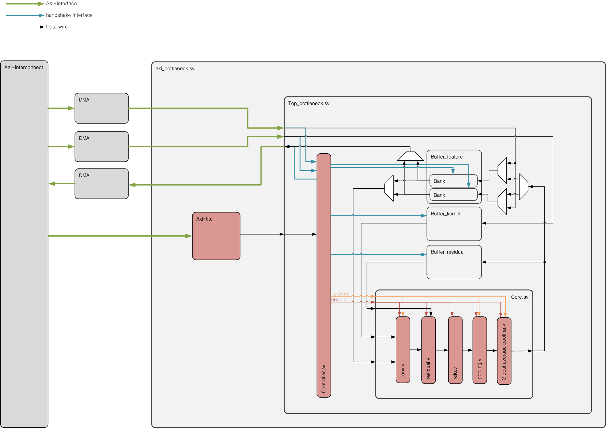

# ResNet-20 Accelerator on FPGA

### 회로 디자인
- Block disign




- verification/[reference_rtl](verification/core/reference_rtl)/*.v
    - 구현 예정인 각 모듈 (완성된 디지털 회로 아님)
    - single MAC 구조
    - mac(conv, fc), relu, pooling등을 수행함.

### Testbench 구성
- [tb_core](tb/tb_core/tb_core.sv)는 단일 lane Q5.10 [더미 core](tb/tb_core/dummy/core.v)를 구동합니다.
  [데이터 스케줄러](tb/tb_core/include/data_schedule.svh)가 feature와 kernel 주소를 계산하고,
  레이어별 출력 수와 타이밍을 확인하고 최종 로짓 10개의 SNR이 50 dB 이상인지 검사합니다.
  기준 로짓은 같은 Q5.10 입력과 가중치로 계산한 양자화 전 Python float 값입니다.

### 참고

```text
- zynq proccessor
    └ ResNet.c
   ↕
- AXI-interconnet
   ↕
- DMA
   ↕
- axi_bottleneck.v              : axi interface 컨트롤
    └ top_bottleneck.v
        └ BRAM_buffer.v         : 버퍼 저장소
        └ bottleneck.v          : 메인 모듈
            ┠ controller.v      : 컨트롤러 (tb의 일부 동작 수행)
            └ core.v            : 연산 수행 모듈 (tb 대상)
                └ mac.v         : dummy rtl 영역
                └ relu.v
                └ ...
```

## 실행 방법

Vivado `bin`과 Python 3.10 이상을 PATH에 추가한 뒤 저장소 루트에서 실행합니다.

### Windows 명령 프롬프트

```bat
scripts\behav_sim.bat tb_core
scripts\synthesis.bat tb_core
scripts\synthesis.bat tb_core --sim
```

`--sim`은 기존 넷리스트로 실행합니다.

`--skip-compile`은 같은 testbench의 기존 XSim 스냅샷을 재사용합니다. RTL이나 testbench를 변경한 내용을 반영하려면 이 옵션 없이 실행합니다.

### Bash

```bash
bash scripts/behav_sim.sh tb_core
bash scripts/synthesis.sh tb_core
bash scripts/synthesis_sim.sh tb_core
```

`synthesis_sim.sh`는 합성부터 실행합니다.

Windows 배치는 기본으로 전체 신호를 `tb/<testbench>/.log/behav_tb.wdb`에 기록합니다. `--gui-live`는 라이브 시뮬레이션을 실행하고, `--gui`는 실행 후 정적 파형을 엽니다. 두 모드 모두 WCFG가 있으면 표시 배치를 불러오고, 없으면 빈 파형 창을 엽니다. `--no-wdb`는 결과 WDB 저장과 정적 `--gui`를 생략합니다. `--gui-live`에서는 Vivado가 라이브 표시에 사용하는 임시 파형 파일만 유지합니다.

`--gui-live`는 XSim 라이브 창을 직접 엽니다. 정적 `--gui`는 저장소에 연결된 Vivado 창을 재사용합니다. 기존 창을 연결하려면 Tcl Console에서 `scripts/wave_viewer.tcl`을 `source`로 한 번 실행합니다. 연결된 창이 없으면 새 창을 엽니다. Bash에서는 기존 `--gui` 옵션을 사용합니다.

출력 소수부 비트 수와 `tb_core`의 skip 지연은 testbench의 `localparam`에 정의합니다. `tb_core`는 `INPUT_GAP` 환경 변수를 지원합니다. `PYTHON`으로 Python 경로를 지정할 수 있습니다.

- 합성 산출물 · `.log/synth/tb_core/zedboard/reference_rtl/`
- 시뮬레이션 로그 · `.log/sim/tb_core/`, `.log/sim/tb_core_synthesis/`

# Appendix

- [기존 Q7.8 bottleneck 테스트 흐름](docs/bottleneck_flow.md)
- [기존 Q7.8 데이터 배치 규칙](docs/appendix.md)

## References

- [IEEE Xplore – Toward Full-Stack Acceleration of Deep Convolutional Neural Networks on FPGAs](https://ieeexplore.ieee.org/document/9354062)
