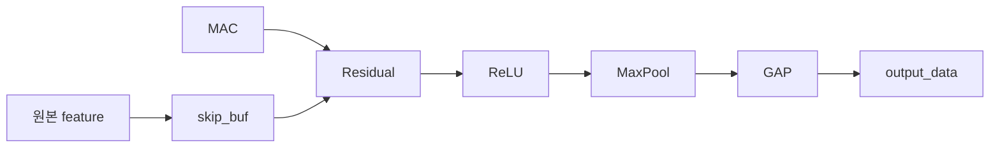
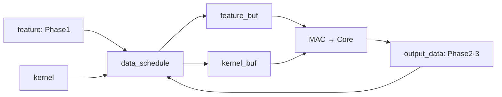

# Bottleneck 구조 · Flow

`6×6×8 · Q7.8 · dummy 모델 · 초기 reset만 사용`

## Core



| Phase | 활성 연산 | 출력 |
|---|---|---|
| 1 | Conv 1×1, 8→2 → ReLU | 6×6×2 |
| 2 | Conv 3×3, pad=1, 2→2 → ReLU | 6×6×2 |
| 3 | Conv 1×1, 2→8 → Residual → ReLU → Pool 2×2 → GAP | 8 |

## 실행

```text
load_data(); core_reset(); scoreboard_init();

for N = 1..3:
    phaseN_data_schedule(source, kernel, ..., feature_buf, kernel_buf, ...)
    phaseN_setup()
    core_run(N, input_count, output_count)
    scoreboard(output_data, output_count, reference_name)

scoreboard_finish(); finish;
```

## 버퍼 재사용



```text
배치 완료 → 전송·수집 완료 → pipeline drain → 검증 → 다음 배치
                              ↑
output_data[i++] ← gap_out_data  if gap_out_enable

feature / kernel             : 원본 보존
feature_buf / kernel_buf     : 공용 MAC 입력
skip_buf                     : Phase3 skip
output_data                  : 현재 phase 출력
모든 배열 용량               : 1296
```

연산 모듈 사이는 `data + out_enable`로 연결합니다. 각 모듈은 같은 클럭에서
입력 수집 task와 이전 결과 출력 task를 실행합니다. TB는 GAP의
`out_enable=1`인 클럭마다 결과를 바로 저장하며, ready와 출력 FIFO는 사용하지 않습니다.

[배치·인터페이스 상세](appendix.md) · [실행 코드](../bottleneck/bench/tb_core/tb_core.sv)
