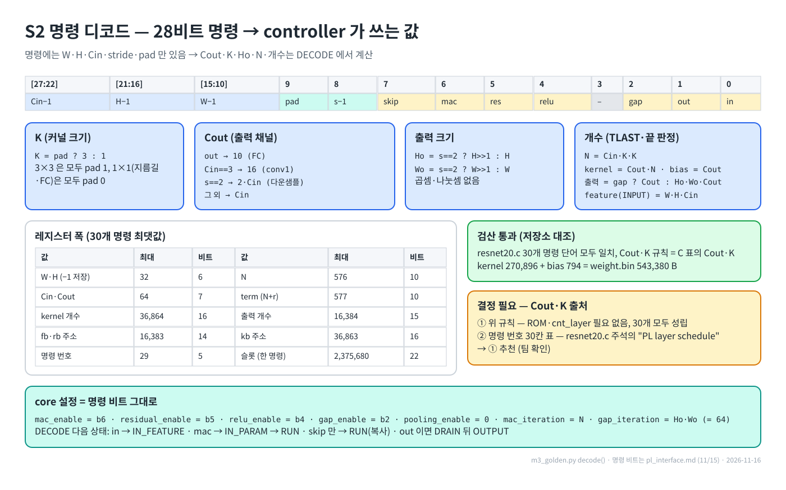
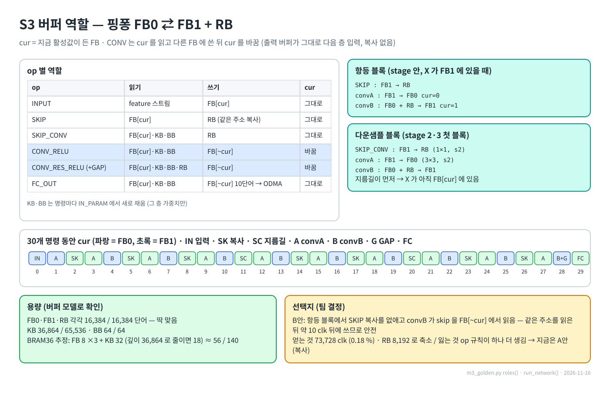
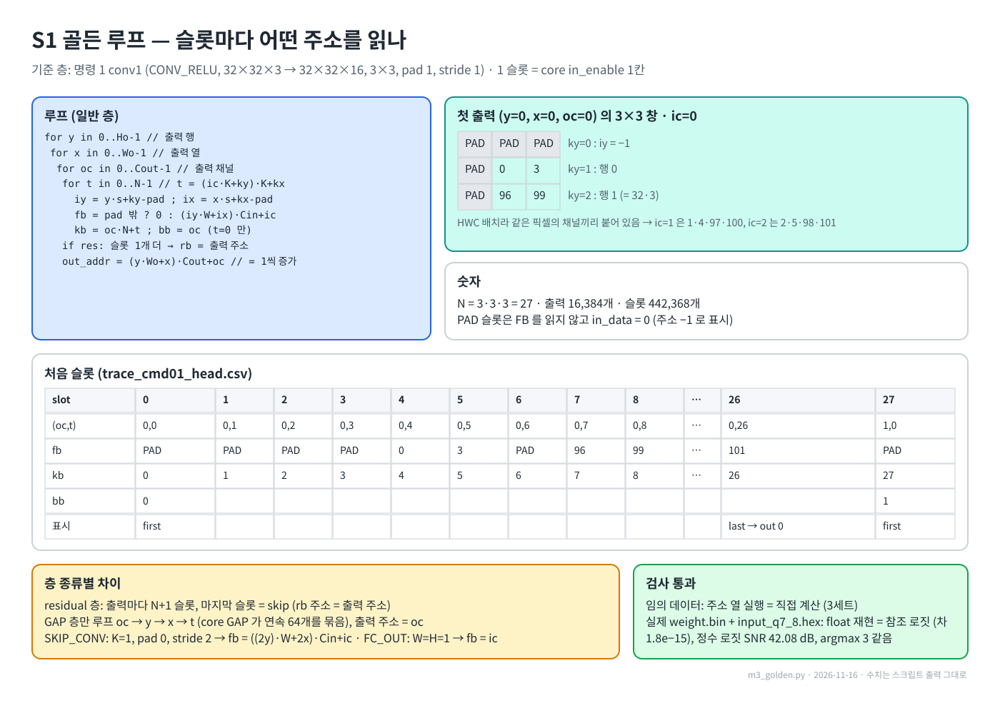

# M3 기준 — S1 골든 루프 · S2 명령 디코드 · S3 핑퐁 버퍼 역할

> 기준일 2026-11-16 · 생성기 `verification/resnet20/m3_golden.py`
> 목적: controller 상태 머신의 전이 조건(= 카운터 끝)을 쓰기 전에 루프·주소·버퍼를 먼저 고정
> 대조한 파일: `resnet20.c`(명령 30개), `resnet20_compute.c`, `weight_bin_spec.md`, `reference_rtl/*.v`, `controller.sv`, `top_bottleneck.sv`

## 한눈에





## 검증한 것

- `resnet20.c` 명령 30개: 단어 30개 모두 일치, C 표의 Cout·K 와 아래 규칙 모두 일치
- 실제 `weight.bin` + `input_q7_8.hex`
  - float 재현 = `reference_logits_float.txt` (최대 차 1.8e−15) → 가중치 순서·입력 HWC 해석 확인
  - 주소 열 + 핑퐁 역할표로 계산한 정수 로짓 SNR 42.08 dB (판정 30 dB), argmax 3 같음
- 임의 데이터 3세트: 주소 열 실행 = 버퍼 없이 직접 계산 (로짓 10개 모두 일치)

## S2 · 명령 디코드

- 명령에 있는 것: in/out/gap/relu/res/mac/skip, stride, pad, W, H, Cin
- DECODE 에서 만드는 것
  - `K = pad ? 3 : 1`
  - `Cout = out ? 10 : (Cin==3 ? 16 : (s==2 ? 2·Cin : Cin))`
  - `Ho = s==2 ? H>>1 : H`, `Wo` 같음
  - `N = Cin·K·K`, `kernel = Cout·N`, `bias = Cout`, `출력 = gap ? Cout : Ho·Wo·Cout`, `feature = W·H·Cin`
- core 설정은 명령 비트 그대로: `mac_enable=b6, residual_enable=b5, relu_enable=b4, gap_enable=b2, pooling_enable=0, mac_iteration=N, gap_iteration=Ho·Wo`
- DECODE 다음: in → IN_FEATURE · mac → IN_PARAM → RUN · skip 만 → RUN(복사) · out 이면 DRAIN 뒤 OUTPUT
- 명령 30개 표: `m3_out/commands_30.csv`

## S3 · 버퍼 역할 (핑퐁)

- CONV·CONV_RES(+GAP): `FB[cur]` 읽기 → `FB[~cur]` 쓰기 → cur 바꿈. 출력 버퍼가 그대로 다음 층 입력
- SKIP: `FB[cur]` → RB 같은 주소 복사 · SKIP_CONV: `FB[cur]` 로 1×1 s2 → RB · 둘 다 cur 그대로
- 다운샘플 블록은 SKIP_CONV 가 convA 보다 먼저 (resnet20.c 순서와 같음)
- FC_OUT: 10 단어를 `FB[~cur]` 에 쓰고 OUTPUT 상태에서 ODMA 로
- 용량: FB0·FB1·RB 16,384 단어 딱 맞음, KB 36,864 / 65,536, BB 64 / 64
- `buffer.v` 는 쓰기 1포트 + 읽기 1포트(1 clk) → 모든 op 에서 포트 충돌 없음

## S1 · 골든 루프

```
for y in 0..Ho-1: for x in 0..Wo-1: for oc in 0..Cout-1:        // GAP 층만 oc → y → x
  for t in 0..N-1:                                               // t = (ic·K+ky)·K+kx
    iy = y·s+ky-pad ; ix = x·s+kx-pad
    fb = (iy,ix 범위 밖) ? PAD(in_data=0) : (iy·W+ix)·Cin+ic
    kb = oc·N+t ;  bb = oc (mac 이 t=0 에서만 씀)
  if res: 슬롯 1개 더 (in_data = RB[rb]), rb = (y·Wo+x)·Cout+oc
  out_addr = (y·Wo+x)·Cout+oc      // 일반 층은 0,1,2,… 순서대로
```

- conv1: N=27, 출력 16,384, 슬롯 442,368
- M3 통과 기준 파일: `m3_out/golden/cmd01_conv1_FB1.hex` (conv1 출력 16,384 단어, FB1 주소 순서)
- 전체 주소 열: `python m3_golden.py --trace 1` → `m3_out/trace_cmd01.csv` (약 18 MB)
- 층별 골든 전부: `python m3_golden.py --weights ../../tb/tb_axi_bottleneck/resnet20/data/weight.bin --input ../../tb/tb_axi_bottleneck/resnet20/data/input_q7_8.hex --ref ../../tb/tb_axi_bottleneck/resnet20/data/reference_logits_float.txt --out m3_out`

## 결정 필요

- Cout·K 출처: 위 규칙(추천, cnt_layer 불필요) vs 명령 번호 30칸 표(resnet20.c 주석 "PL uses its layer schedule")
- SKIP 복사 유지(A, 지금) vs 항등 블록에서 skip 을 `FB[~cur]` 에서 읽기(B, 73,728 clk·RB 절반 절약)

## controller.sv 에 바로 연결되는 것 (11/16 파일 기준, 논리만)

- `network_t` 는 enum 대신 명령 비트를 그대로 쓰면 됨 (op 7개 + IDLE, 일반 CONV 는 없음)
- 포트에 주소가 없음 → 추가할 것: FB0/FB1 읽기·쓰기 주소와 we, cur 선택, KB·BB·RB 주소, in_data 선택(FB / RB skip / 0 패딩)
- `fmem_rd_valid/ready` 같은 핸드셰이크는 BRAM 에 없음 → 고정 1 clk 지연으로 맞춤 (S7)
- `counter_iteration_mac` 끝 값은 상수가 아니라 DECODE 의 N−1
- `top_bottleneck.sv` 의 `u_mem_2` 는 핑퐁이면 필요 없음 (FB 2개 + RB)
