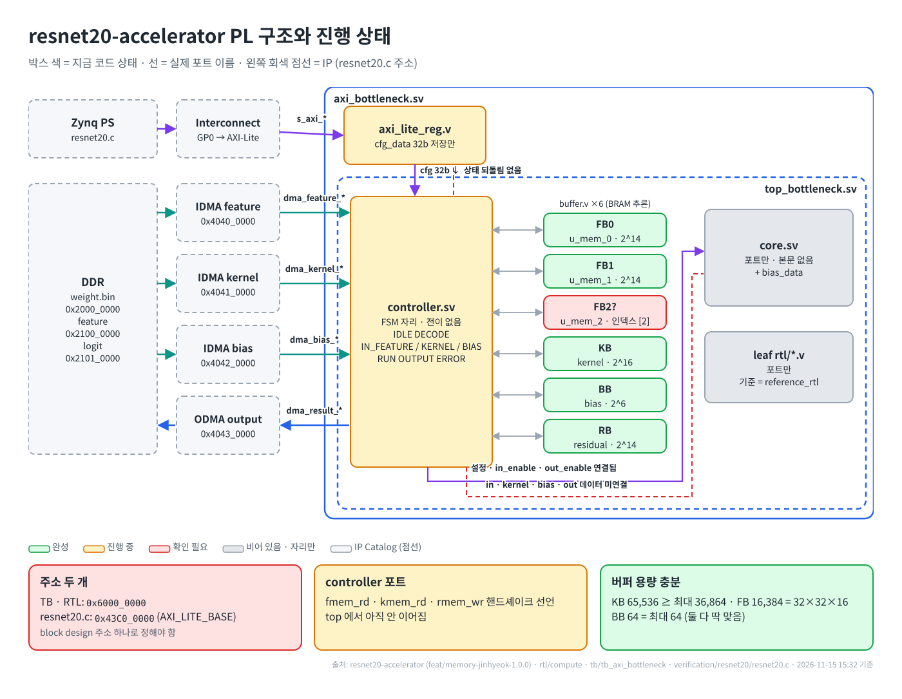
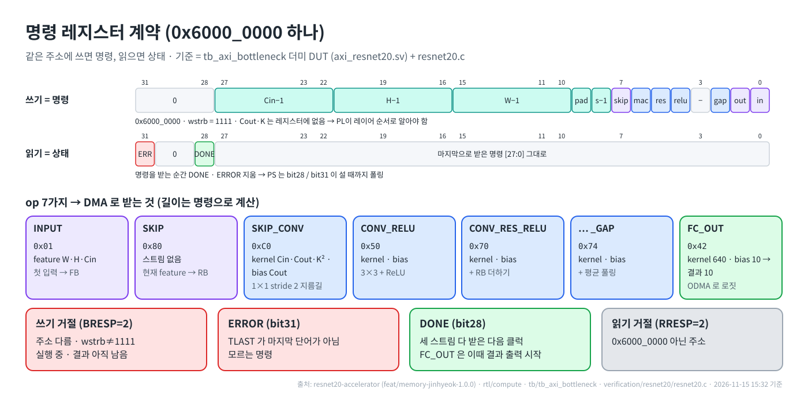
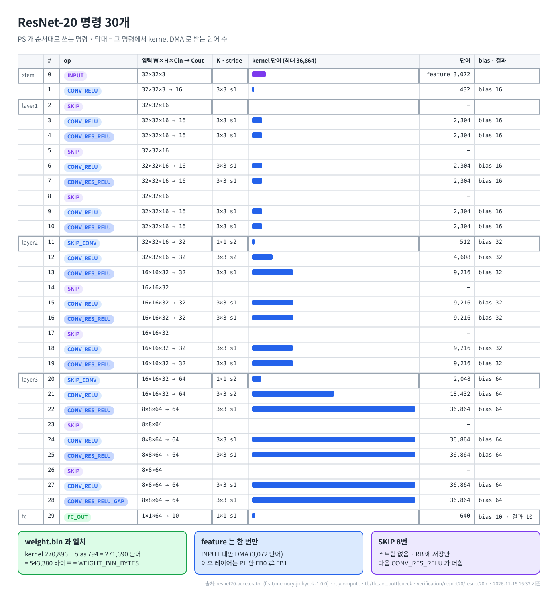
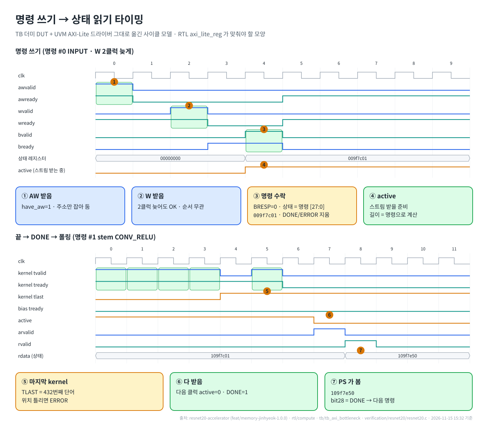
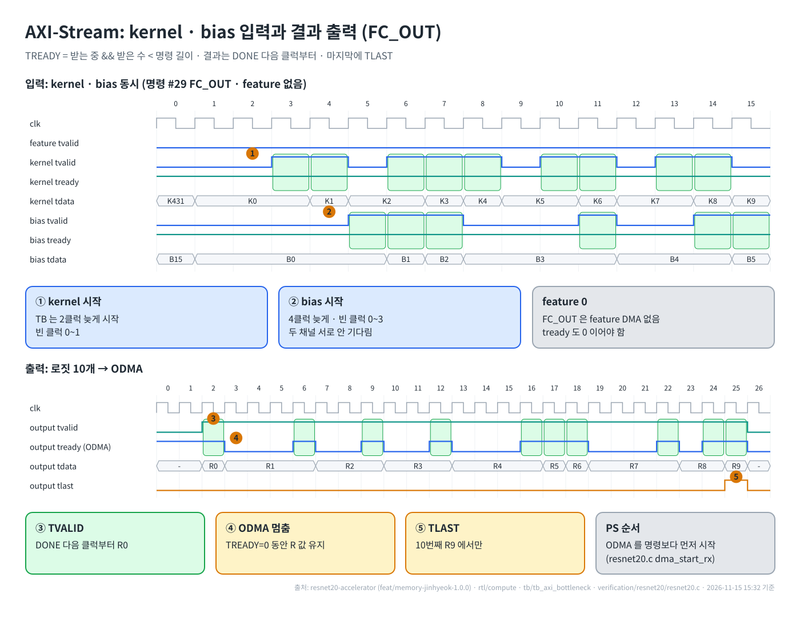
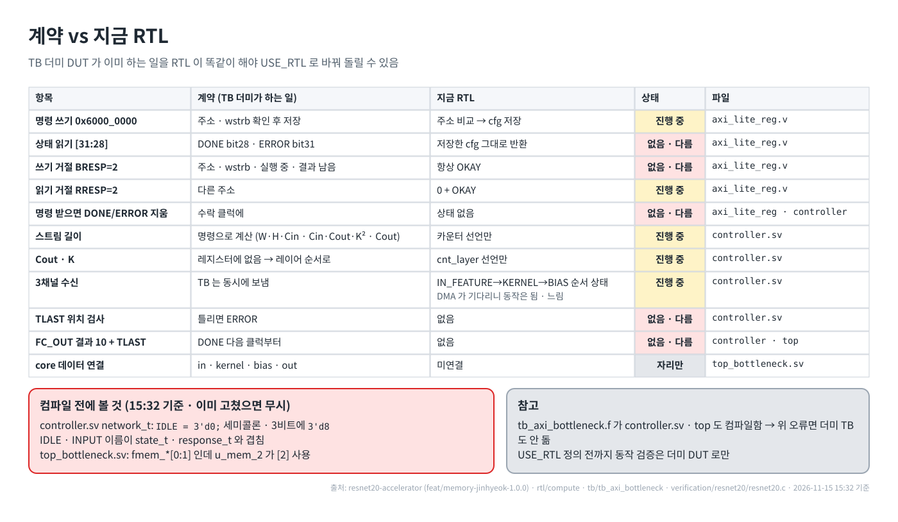
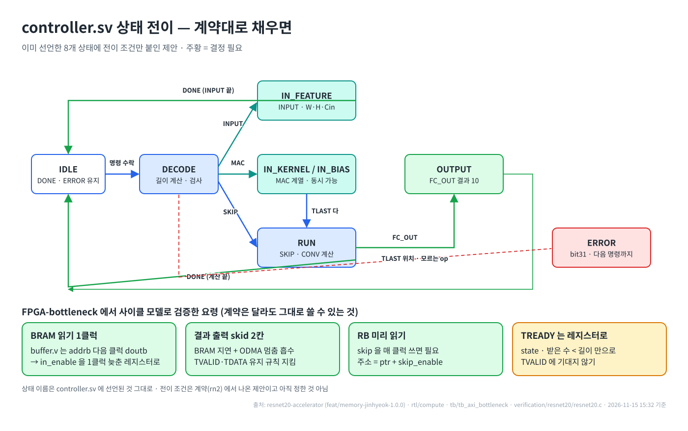

# PL 인터페이스 — 명령 레지스터 · AXI · controller

> 기준: `feat/memory-jinhyeok-1.0.0` · 2026-11-15 15:32 · RTL 파일은 수정하지 않음 (그림·문서만)
> 계약 = `tb/tb_axi_bottleneck` 더미 DUT(`resnet20/axi_resnet20.sv`) + `verification/resnet20/resnet20.c`

---

## 1. 지금 구조와 진행 상태

## 2. 명령 레지스터 계약

## 3. ResNet-20 명령 30개

## 4. 타이밍 (TB 더미 + UVM 드라이버)

## 5. 계약 vs 지금 RTL

## 6. controller 전이 (제안)

---

- 파형은 TB 더미 DUT · `axi_lite_driver` · `axis_driver` · `model_run_seq` 를 사이클 단위로 옮긴 모델에서 뽑음 (seed 고정)
- RTL 이 더미와 같아지면 `tb_axi_bottleneck.sv` 맨 위 `` `define TB_AXI_BOTTLENECK_USE_RTL `` 로 바꿔 검증
