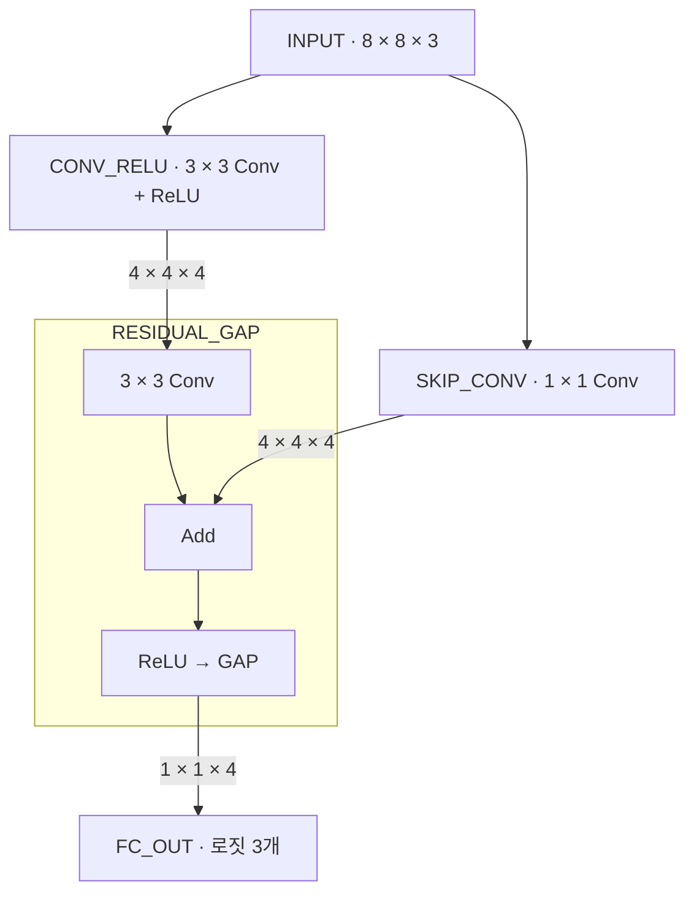

# Toy 모델

## 레이어 구성

## Instruction 실행 순서

| 순서 | Instruction |
| ---: | --- |
| 1 | `INPUT` |
| 2 | `SKIP_CONV` |
| 3 | `CONV_RELU` |
| 4 | `RESIDUAL_GAP` |
| 5 | `FC_OUT` |

## 레이어별 크기

입출력은 `H × W × C`, 커널은 `Cout × Cin × Kh × Kw` 순서로 표기합니다. 바이어스 크기는 원소 수입니다.

| Instruction | 입력 크기 | 커널 크기 (원소 수) | 바이어스 크기 | 출력 크기 |
| --- | --- | --- | ---: | --- |
| `INPUT` | 8 × 8 × 3 | — | — | 8 × 8 × 3 |
| `SKIP_CONV` | 8 × 8 × 3 | 4 × 3 × 1 × 1 (12) | 4 | 4 × 4 × 4 |
| `CONV_RELU` | 8 × 8 × 3 | 4 × 3 × 3 × 3 (108) | 4 | 4 × 4 × 4 |
| `RESIDUAL_GAP` | 4 × 4 × 4 (메인), 4 × 4 × 4 (스킵) | 4 × 4 × 3 × 3 (144) | 4 | 1 × 1 × 4 |
| `FC_OUT` | 1 × 1 × 4 | 3 × 4 × 1 × 1 (12) | 3 | 1 × 1 × 3 (로짓 3개) |

`SKIP_CONV`와 `CONV_RELU`는 `INPUT`의 출력을 각각 사용합니다. `RESIDUAL_GAP`은 메인 경로의 합성곱 결과에 `SKIP_CONV` 출력을 더한 뒤 ReLU와 GAP을 적용합니다.
